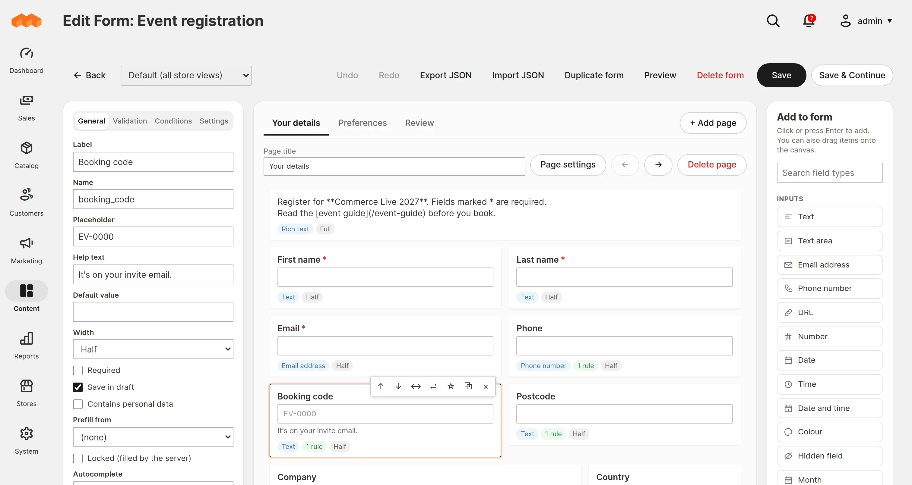
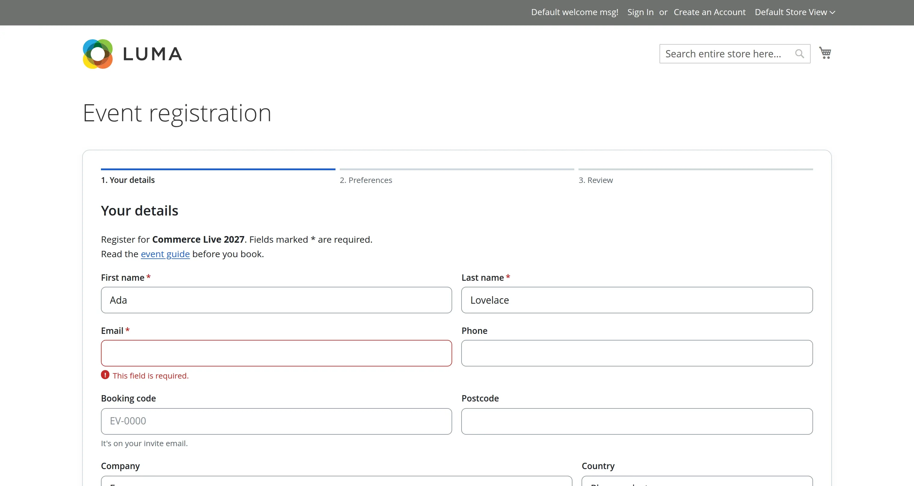
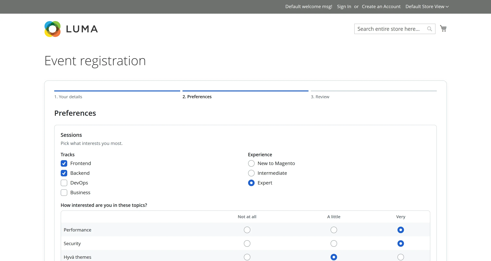
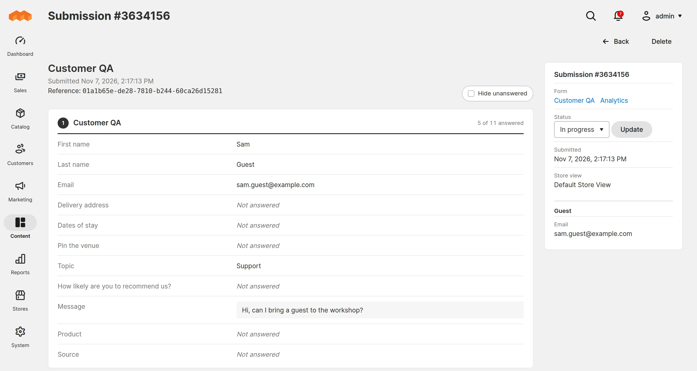

# Furan_FormBuilder

A drag-and-drop form builder for the Magento and Mage-OS admin. Build multi-page forms with conditional logic, publish them on their own URL or in CMS content, and handle the submissions in the admin. Works on Luma and Hyvä.

<table>
  <tr>
    <td width="50%"></td>
    <td width="50%"></td>
  </tr>
  <tr>
    <td width="50%"></td>
    <td width="50%"></td>
  </tr>
</table>

## Requirements

- Magento 2.4.4 to 2.4.9, or Mage-OS
- PHP 8.1+ with the zip extension
- `Magento_Catalog`, `Magento_Config`, `Magento_Cron`, `Magento_Csp`, `Magento_Sitemap` and the message queue framework
- Optional: the reCAPTCHA, newsletter and sales modules

## Install

```
composer require furan/magento-form-builder
bin/magento module:enable Furan_FormBuilder
bin/magento setup:upgrade
```

Then:

1. Make sure Magento cron is running. Uploads cleanup, retention, schedules, analytics and webhook retries depend on it.
2. The module has five queue consumers: `furan_formbuilder.webhook`, `furan_formbuilder.action`, `furan_formbuilder.mail`, `furan_formbuilder.export` and `furan_formbuilder.privacy`. Cron starts them; if `env.php` keeps a `cron_consumers_runner/consumers` allowlist, add them there, or run them yourself. [Operations](docs/operations.md) says when each one is needed.
3. Behind a load balancer, CDN or Varnish, list their addresses under **Stores → Configuration → Furan → Form Builder → Spam Protection → Trusted Proxy IPs**.
4. Create a form under **Content → Form Builder → Forms**. It is live at `/forms/<identifier>`, or insert it anywhere with the **Form Builder Form** widget.

## Features

- **Fields**: 32 types, from text and choices to address, map pin, star rating, NPS, Likert matrix and file upload, plus presets such as full name and terms consent.
- **Builder**: live preview on a 6-column grid, pages and sections, drag and drop, keyboard reordering, undo and redo.
- **Conditional logic**: show, hide, require, set a value or hide options, with nested groups, field comparisons and dates relative to today. Pages can be skipped.
- **Validation**: the same rules run in the browser and in PHP, and every submission is re-validated against the stored form. Reusable saved rules with a live tester.
- **Input masks**: phone numbers, postcodes, sort codes and custom patterns.
- **Field groups**: save a set of fields once and insert copies into other forms.
- **Schedule**: open and close a form at set times.
- **Reference**: every submission gets a reference the visitor and staff can quote.
- **Newsletter**: an optional opt-in through `Magento_Newsletter`.
- **Submissions**: statuses, email replies with a conversation thread, CSV export and retention.
- **Customers**: prefill, login and group restrictions, one answer per customer, and My submissions in the customer account.
- **Privacy**: per-field personal data flag, GDPR export and erase, and a choice of what happens on account deletion.
- **Spam protection**: honeypot, time trap, rate limits and Magento's reCAPTCHA.
- **Webhooks**: signed Standard Webhooks deliveries with retries, a delivery log and replay.
- **Analytics**: per-question charts from pre-aggregated tables.
- **Store views**: per-store-view translations, SEO fields and sitemap entries. Language packs for 9 locales.

## Documentation

| Page | Covers |
| --- | --- |
| [Building forms](docs/forms.md) | Fields, conditions, validation, masks, field groups, schedule, translations, appearance |
| [Submissions and customers](docs/submissions.md) | Admin handling, replies, My submissions, emails, analytics, privacy |
| [Webhooks](docs/webhooks.md) | Setup, payload, retries, replay, `env.php` settings, verifying signatures |
| [Operations](docs/operations.md) | Configuration, cron and queues, CLI, proxies and multiple servers, security, known limits |
| [Extending](docs/extending.md) | Pools, field types, events, services, storefront and builder JavaScript, the form schema |

## License

See [LICENSE](LICENSE).
